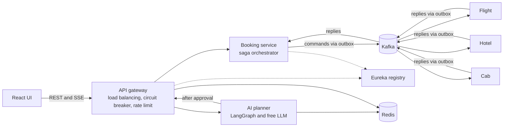

# Trip Saga

Event-driven trip booking: **flight + hotel + cab** are booked as one distributed transaction (orchestrated saga) with automatic compensation on failure. An AI trip planner (LangGraph) and a React UI come in later phases.



## Architecture (Phase 0-1)

| Piece | Tech | Role |
|---|---|---|
| service-registry | Spring Cloud Netflix Eureka | **Service discovery** |
| api-gateway | Spring Cloud Gateway | Single entry point, **client-side load balancing** (`lb://`), **circuit breaker** (Resilience4j) with fallback, **Redis rate limiting** |
| booking-service | Spring Boot, Kafka, Postgres | **Saga orchestrator**, owns the `booking` DB |
| provider-service | Spring Boot, Kafka, Postgres | Mock flight / hotel / cab (same code, 3 deployments, 3 DBs) |
| Kafka (KRaft) | | Commands per provider + `saga.replies`, keyed by bookingId |

Flow: `POST /api/bookings` -> gateway -> booking-service -> `flight.commands` -> reply -> `hotel.commands` -> reply -> `cab.commands` -> `CONFIRMED`.
On failure at step N, steps N-1..1 are cancelled in reverse order -> `CANCELLED`.

## Run

```bash
docker compose up --build --scale booking-service=2
```
Wait ~40s for services to register, then check http://localhost:8761 (Eureka dashboard).

## Try it

```bash
# Happy path
curl -s -X POST localhost:8080/api/bookings -H 'Content-Type: application/json' \
  -d '{"destination":"Goa","budget":30000,"notes":""}'

# Hotel fails -> flight is compensated
curl -s -X POST localhost:8080/api/bookings -H 'Content-Type: application/json' \
  -d '{"destination":"Goa","budget":30000,"notes":"FAIL_HOTEL"}'

# Poll status
curl -s localhost:8080/api/bookings/<id>
```
Expected: happy path ends `CONFIRMED` (completedSteps FLIGHT,HOTEL,CAB); `FAIL_HOTEL` ends `CANCELLED` with `failureReason` set.

## Resilience checks to try

- `docker compose stop booking-service`, then call the API: after a few failures the circuit opens and you get the 503 fallback. Start it again and it recovers (half-open -> closed). Inspect at `/actuator/circuitbreakers` on the gateway.
- Scale `booking-service` to 2 and watch requests spread across both instances.
- Hit the endpoint in a loop to see Redis rate limiting return 429.

## Phase 2: reliability (implemented)

| Concern | How |
|---|---|
| Lost events (DB write + Kafka publish not atomic) | **Transactional outbox**: state change and message are one DB transaction; `OutboxRelay` publishes (polling, `FOR UPDATE SKIP LOCKED`, at-least-once) |
| Duplicate delivery | **Idempotent consumers**: `processed_messages` inbox table commits with the business change |
| Poison / failing messages | Retry with **exponential backoff**, then **dead-letter topic** (`<topic>.DLT`) |
| Provider never answers | **Saga timeout sweeper** compensates stuck bookings |
| Provider answers after timeout | Late reservation is detected and **cancelled** (no orphan reservations) |

### Demos worth recording

```bash
# 1. Outbox: Kafka down, API still accepts the booking (row waits in outbox_events)
docker compose stop kafka
curl -s -X POST localhost:8080/api/bookings -H 'Content-Type: application/json' -d '{"destination":"Goa","budget":30000,"notes":""}'
docker compose start kafka          # relay publishes, booking completes

# 2. Service crash: stop hotel-service, create a booking, start it again within 30s -> CONFIRMED
docker compose stop hotel-service

# 3. Poison message: retries, then lands in the DLT; saga times out and compensates
curl -s -X POST localhost:8080/api/bookings -H 'Content-Type: application/json' -d '{"destination":"Goa","budget":30000,"notes":"CRASH_HOTEL"}'
docker compose exec kafka /opt/kafka/bin/kafka-console-consumer.sh --bootstrap-server kafka:9092 --topic hotel.commands.DLT --from-beginning
```

## Phase 2b: CDC, replay, tests

**Debezium CDC (optional mode).** The default is the polling relay. To let Debezium publish the outbox table from the Postgres WAL instead:

```bash
OUTBOX_RELAY_ENABLED=false docker compose --profile cdc up --build --scale booking-service=2
curl -s localhost:8083/connectors            # outbox-booking, outbox-flight, outbox-hotel, outbox-cab
```
Debezium's EventRouter reads each inserted outbox row and routes it to the topic named in its `topic` column, keyed by `message_key`. Postgres runs with `wal_level=logical`.

**DLT replay.** After fixing the cause of a poison message, re-publish it:
```bash
curl -s -X POST 'localhost:8080/api/admin/dlt/replay?topic=hotel.commands'
```
Replayed messages carry `x-replayed: true`; the mock provider treats that as "bug fixed" and skips the simulated `CRASH_` failure. A late reservation after the saga already timed out is detected and cancelled.

**Tests.** `mvn verify` runs `SagaIntegrationTest` (Testcontainers: real Postgres and Kafka, faked providers): happy path, compensation, provider timeout, duplicate reply. Needs Docker. GitHub Actions runs the same via `.github/workflows/ci.yml`.

## Phase 3: React UI with live saga progress

`frontend/` is React + TypeScript + Vite. It shows a trip's flight / hotel / cab steps updating live, and the rollback when one fails.

```bash
docker compose up --build --scale booking-service=2     # backend
cd frontend && npm install && npm run dev               # UI on http://localhost:5173
```
Use "Try a failure" in the form to watch a rollback (for example "Hotel is full": the flight turns amber and is released).

How live updates work: every state change writes a timeline event and a `booking.updates` outbox message in the same transaction. Each booking-service instance consumes that topic with its **own consumer group**, reloads the booking, and pushes it to its connected SSE clients, so streaming works with several replicas behind the load balancer. The gateway has a separate `/api/stream/**` route with no circuit-breaker timeout, since streams are long-lived.

## Phase 4: AI trip planner (free LLM)

`ai-service/` is Python (FastAPI + LangGraph). Describe a trip in plain words; the graph parses it, searches mock flight/hotel/cab options (Redis-cached), drafts an itinerary, checks the budget (revising up to twice), then **pauses for human approval**. Only after you approve does it start the booking saga.

Pick any free model (copy `.env.example` to `.env`):

| Option | Setup | Notes |
|---|---|---|
| Groq | free API key, no card | fastest to start, rate-limited per model |
| Google Gemini | free key from AI Studio | free tier covers Flash models |
| Ollama | `ollama pull llama3.2`, set `OLLAMA_BASE_URL` | fully local; slower without a GPU |
| none | nothing | built-in deterministic planner, so the app still works |

Free-tier limits change often, so check the provider's current rate-limit page before relying on them.

```bash
cp .env.example .env        # add your key
docker compose up --build --scale booking-service=2
cd frontend && npm install && npm run dev
```

Reliability and safety choices worth mentioning in interviews: model output is validated (ids must exist, days padded, destination sanitized) and falls back to the built-in planner on any failure; the gateway gives the planner its own circuit breaker, a 45s timeout and a stricter rate limit to protect free quotas; booking notes are never taken from model output; results are cached in Redis; token usage is tracked per plan.

Logic tests: `cd ai-service && pip install -r requirements.txt && pytest`.

## Phase 5-7: observability, load testing, shipping

**Metrics and dashboards.** Every Spring service exposes `/actuator/prometheus`. The orchestrator records `saga.completed` (by outcome), `saga.duration` (histogram), `saga.step.failed` and `saga.timeouts`. Prometheus scrapes every replica; Grafana provisions a "Trip Saga" dashboard automatically.

**Distributed tracing.** OpenTelemetry traces go to Jaeger. The trace context is stored on each outbox row and sent as a `traceparent` Kafka header (also mapped by Debezium in CDC mode), so one booking is one trace across gateway, orchestrator, Kafka and providers.

```bash
TRACING_ENABLED=true docker compose --profile obs up --build --scale booking-service=2
# Grafana http://localhost:3001   Jaeger http://localhost:16686   Prometheus http://localhost:9090
# App (built UI) http://localhost:3000
```

**Load test.** `loadtest/booking.js` ramps up to 50 bookings/s, forces 10% to fail, polls until each saga finishes, and checks both latency and correctness (no unfinished sagas, no wrong outcomes). Raise the gateway rate limit first: `GATEWAY_RATE=100000 GATEWAY_BURST=100000`. Record your numbers in `docs/RESULTS.md`.

**Docs.** `docs/DECISIONS.md` lists each design decision with its trade-off and the known limitations; use it as your interview script.

**Deploy.** The whole stack is one `docker compose up` on a single VM (any 4 GB+ machine with Docker). The `frontend` container serves the UI on port 3000 and proxies `/api` to the gateway, with buffering off so SSE works.

## Roadmap

- [x] Phase 0-1: infra, registry, gateway, happy-path + compensating saga
- [x] Phase 2: outbox, idempotent consumers, retries + DLT, saga timeout
- [x] Phase 2b: Debezium CDC mode, DLT replay endpoint, Testcontainers tests, CI
- [x] Phase 3: React UI with live saga progress (SSE)
- [x] Phase 4: LangGraph trip planner with human approval, free LLM support
- [x] Phase 5-7 (code): metrics, tracing, k6 test, frontend container, CI for all three stacks, design docs
- [ ] You: run it, fill in `docs/RESULTS.md`, record a 2 minute demo, deploy to a VM
- [ ] Later polish: streamed plan response, Postgres checkpointer, Flyway, auth on admin endpoints
